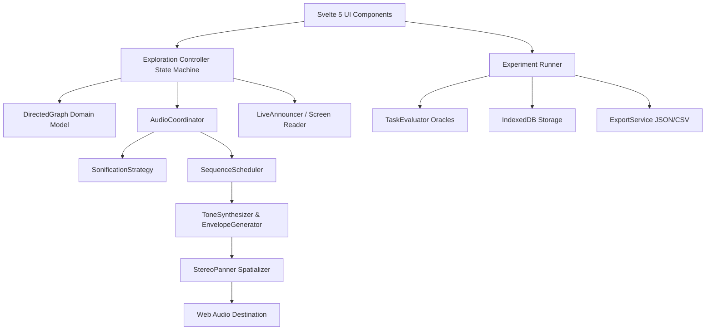

# Architecture & Technical Design

## 1. Overview

**Auditory Graph Explorer** is a research prototype engineered to investigate whether interactive auditory representations and stereo spatialization support blind and low-vision users in constructing accurate mental models of directed network graphs.

The application is architected around strict separation of concerns, ensuring that graph topological logic, state management, audio DSP synthesis, accessibility live-regions, and research data instrumentation operate independently.

---

## 2. Core Modules

### 2.1 Graph Domain (`src/domain/graph/`)
- **`DirectedGraph`**: Pure data structure utilizing Graphology for internal graph storage. Provides deterministic queries for in/out neighbors, reachability BFS, shortest path, all simple paths, cycle detection, branching nodes ($\text{out-degree} \ge 2$), and convergence nodes ($\text{in-degree} \ge 2$).
- **`GraphParser`**: Parses and exports Graphviz DOT (`digraph { ... }`) and JSON schemas.
- **`DeterministicGraphGenerator`**: Seeded Mulberry32 pseudo-random generator producing structurally matched graphs with controlled difficulty characteristics (density, cycles, branching, convergence).

### 2.2 Navigation Controller (`src/domain/navigation/`)
- **`ExplorationController`**: Decoupled state machine managing focused node, direction (`outgoing` | `incoming`), neighbor cursor index, history stack for backtracking, start node reset, and exact node inspection.
- Emits atomic state change events, playback requests, and screen reader announcements.
- Logs all user actions with high-precision monotonic timestamps (`performance.now()`).

### 2.3 Audio Engine (`src/audio/`)
- **`AudioContextManager`**: Safe Web Audio context lifecycle management with a `DynamicsCompressorNode` brickwall limiter to prevent hearing fatigue or clipping.
- **`ToneSynthesizer` & `EnvelopeGenerator`**: Programmable tone synthesis with customizable ADSR envelopes (`exponentialRampToValueAtTime`) avoiding audio discontinuities or clicks.
- **`Spatializer`**: Stereo panning via `StereoPannerNode`, distributing incoming relationships across the left channel ($-0.8 \dots 0.0$) and outgoing relationships across the right channel ($0.2 \dots 0.8$).
- **`SequenceScheduler`**: Schedules timed microtonal sequences with instant cancellation and replay capabilities.
- **`SonificationStrategy`**: Deterministically maps graph semantics into abstract audio sequences using a 2-octave pentatonic frequency scale ($C_4 \dots C_6$).

### 2.4 Research & Experimentation (`src/research/`)
- **`ExperimentRunner`**: Manages experimental lifecycle: Consent $\to$ Calibration $\to$ Practice Training $\to$ Counterbalanced Condition Blocks $\to$ NASA-TLX Workload $\to$ Results.
- **`Counterbalance`**: Latin Square condition order assignment (`A-B-C`, `B-C-A`, `C-A-B`, `A-C-B`, `B-A-C`, `C-B-A`).
- **`TaskEvaluator`**: Automated, objective topological scoring oracles for branch detection, convergence detection, reachability queries, cycle detection, and mental model edge reconstruction.
- **`ExportService`**: Exports raw session data in JSON and trial-level summary tables in standard CSV.

### 2.5 Storage (`src/storage/`)
- **`IndexedDBStorage`**: Local client-side storage for session persistence, enabling session resumption and privacy-preserving local execution with full deletion support.
